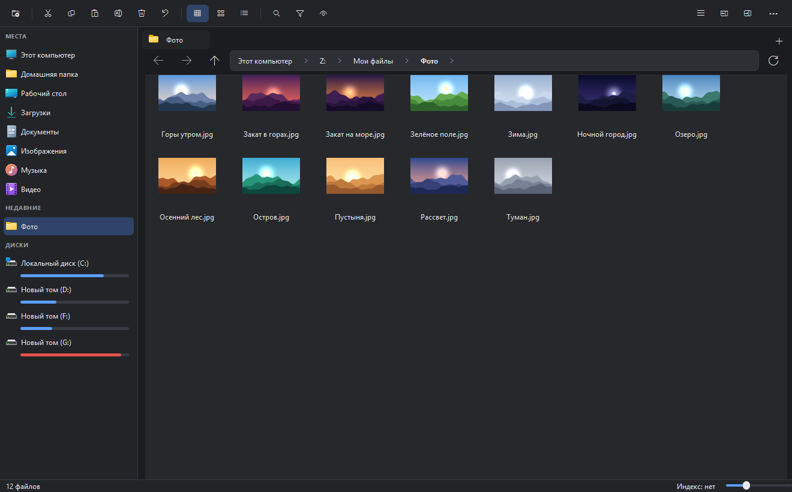
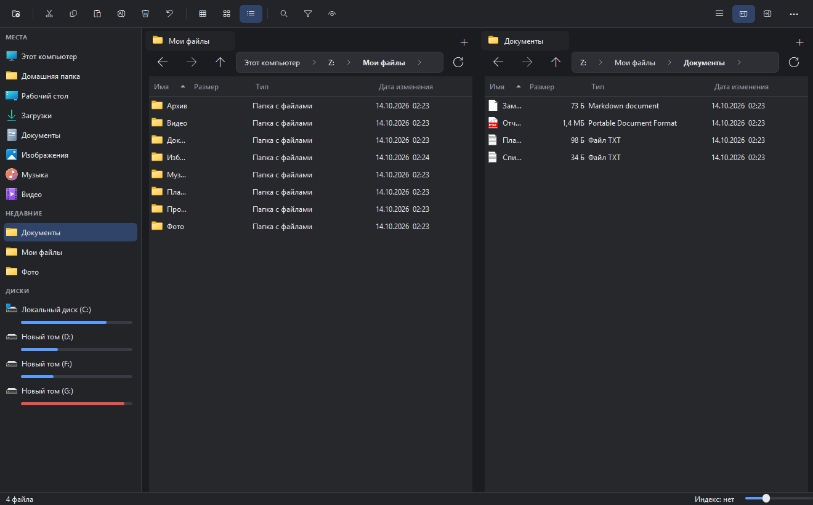
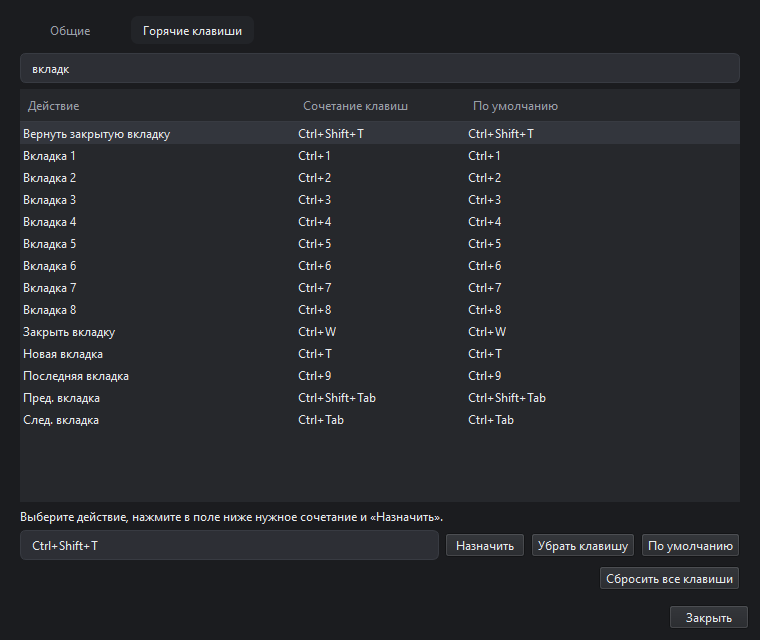
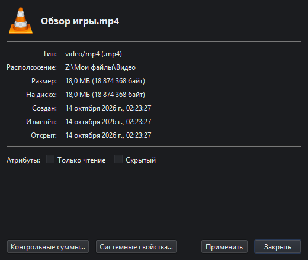
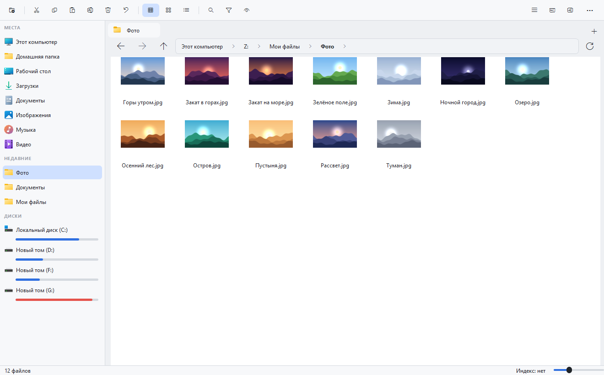

# Orca 🐋 — быстрый файловый менеджер для Windows

Orca — это проводник для Windows в духе **Dolphin** из KDE: вкладки, две панели, быстрый поиск,
горячие клавиши на любой вкус. Настоящее приложение (Python + Qt), без браузера внутри и без сервера:
открывается мгновенно, не тормозит на папках с десятками тысяч файлов.



## Что умеет

- **Скорость.** Папка на 30 000 файлов открывается за доли секунды, «выделить всё» не подвешивает окно.
  Значки и миниатюры (фото, видео, PDF, музыка) подгружаются в фоне.
- **Вкладки и две панели.** `Ctrl+T` / `Ctrl+W`, `Ctrl+1…9` — как в браузере; `F3` — две панели, `F7` / `F8` — копия / перенос в соседнюю.
- **Три вида:** значки, компактно, подробно (`Ctrl+Shift+1 / 2 / 3`).
- **Поиск.** `Ctrl+F` — по папке и вложенным; `Ctrl+Shift+F` — по всему ПК через [Everything](https://www.voidtools.com/) (если она установлена; результаты за доли секунды, поиск по мере набора) или через собственный индекс.
- **Свои горячие клавиши** для любого из 70+ действий: `Ctrl+,` → «Горячие клавиши».
- **Быстрый просмотр по пробелу** (картинки, текст, видео, PDF, папки), цветные метки (`Ctrl+M`), терминал в текущей папке (`F4`).
- **Массовое переименование** (`F2` на нескольких файлах) с таблицей «было → станет» и отменой.
- **Поиск дубликатов** по содержимому и **сравнение двух папок**.
- **Архивы `.zip` открываются как папки** (только чтение, с защитой от выхода за пределы папки).
- **Своё окно «Свойства»** (`Alt+Enter`): размер, «на диске», даты, число файлов в папке, атрибуты, контрольные суммы.
- Контрольные суммы MD5 / SHA-1 / SHA-256 с проверкой, размер папки в фоне, выделение по маске (`Ctrl+S`), быстрые команды (`Ctrl+Shift+P`).
- Родное контекстное меню Windows (с «Отправить», «Открыть с помощью» и пунктами других программ) и перетаскивание файлов в другие программы.
- Тёмная и светлая темы.

| Две панели | Горячие клавиши | Свойства |
|---|---|---|
|  |  |  |



## Безопасность файлов

Orca ничего не удаляет сама по себе: по умолчанию `Delete` отправляет в **корзину Windows**
(оттуда можно восстановить), для папок и пяти и более объектов спрашивает подтверждение, `Ctrl+Z` отменяет
переименование, создание папки, копирование и перенос. Все операции записываются в журнал
`%APPDATA%\Provodnik\actions.log` — если вдруг что-то пропало, там видно, что делала программа.
При сбое причина пишется в `%APPDATA%\Provodnik\orca.log`.

## Установка

Скачайте со страницы **Releases**:

- `Orca-Setup-<версия>.exe` — установщик (ярлыки, удаление через «Параметры → Приложения»), права администратора не нужны;
- или `Orca-<версия>.zip` — портативная версия: распакуйте папку целиком и запустите `Orca.exe`.

Нужна Windows 10 или 11. Программа не подписана цифровой подписью, поэтому SmartScreen может написать
«Windows защитила ваш компьютер» — нажмите «Подробнее» → «Выполнить в любом случае».

## Запуск из исходников

```bash
pip install PySide6
python app.py
```

Проверено на Python 3.14 и PySide6 6.11.

## Сборка exe и установщика

```bash
pip install pyinstaller
python build_all.py
```

Скрипт собирает `Orca.exe` (PyInstaller), архив и установщик (нужна [Inno Setup 6](https://jrsoftware.org/isinfo.php)).
Версия берётся из `version.py`, список изменений — из `CHANGELOG.md`.

## Тесты

Каждый файл в `tests/` — отдельная проверка (в основном через настоящий интерфейс программы в невидимом окне).
Им нужна папка с тестовыми файлами в качестве аргумента:

```bash
python tests/model_test.py <папка_с_любыми_файлами>
```

Часть проверок удаляет и переносит файлы внутри этой папки — не указывайте свои реальные данные, используйте копию.

## Состояние проекта

Проект молодой, делается в свободное время, пока нет подписи кода. Если нашли ошибку — откройте issue
и приложите `%APPDATA%\Provodnik\orca.log` (при сбое) или `actions.log` (если пропал файл).

Работа с телефоном по ADB присутствовала в версиях до 1.4 и убрана в 1.5.0, пока не проверена на настоящих устройствах.

## Английский вариант

**Orca** is a fast, native file manager for Windows inspired by KDE's Dolphin: tabs, dual panes,
instant search (optional [Everything](https://www.voidtools.com/) integration), fully customizable hotkeys,
quick look on Space, bulk rename, duplicate finder, folder compare, zip archives as folders, thumbnails,
dark/light themes and a safe-by-default delete (Recycle Bin + action log). Built with Python and PySide6 (Qt).
The UI is in Russian for now. Download the installer or portable zip from **Releases**.

## Лицензия

[MIT](LICENSE) — делайте с кодом что угодно, но без гарантий.
